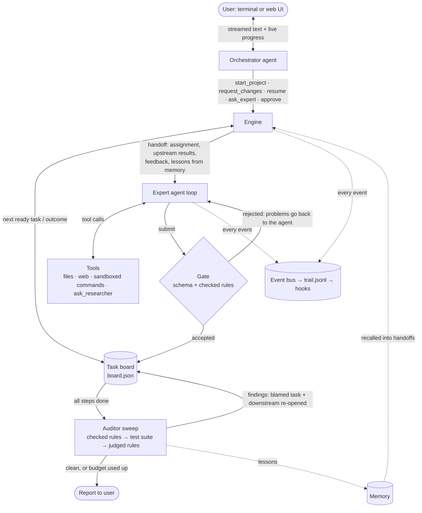

# Research Agent Team

A multi-agent harness that takes a medium-size task ("build an API for consulting a mock database", "build an MCP server for an Obsidian vault") through **Research → Planning → PRD → Spec → Implementation → Audit** and leaves a working, tested minimum viable solution in a workspace.

The orchestration is written from scratch in about 2,600 lines of Python: delegation, task tracking, validation, auditing, re-running, memory, hooks and sandboxing. The only thing left to a library is the connection to the model (the Anthropic SDK for Claude; plain `urllib` for any OpenAI-compatible server such as Ollama).

## Quick start

```bash
python3 -m venv .venv && .venv/bin/pip install -e .      # or: uv venv && uv pip install -e .

# 1. Claude (default): a model per agent role, see Models below
export ANTHROPIC_API_KEY=...
.venv/bin/python -m harness

# 2. An open-source model running locally (no dependency, no key)
ollama pull gpt-oss:20b
.venv/bin/python -m harness --provider openai --model gpt-oss:20b      # --base-url defaults to Ollama

# 3. No model at all: a scripted team that makes every kind of mistake on purpose (until memory holds its lessons, see below)
.venv/bin/python -m harness --provider scripted
```

Then type what you want built. Other entry points and options:

```bash
.venv/bin/python -m harness --serve                       # web UI (chat + live task board) and HTTP gateway on :8765
.venv/bin/python -m harness --serve --host 0.0.0.0        # reachable from other machines (token required)
.venv/bin/python -m harness --sources ./docs              # give the agents reference files to research
.venv/bin/python -m harness --session 20261114-101500     # reopen a session: its board, trail and workspace
.venv/bin/python -m harness --hooks examples/hooks.py     # load policy hooks
.venv/bin/python -m unittest discover -s tests -v         # 69 tests, offline, about 9 seconds
```

Requirements: Linux or macOS (the memory file is locked with `fcntl`, so Windows needs WSL), Python 3.10+, and `bubblewrap` or Docker for the code sandbox (Linux has `bwrap` in every distribution; with Docker the image `python:3.12-slim` is pulled on first use). For local models, raise Ollama's context window first (its default is small): `OLLAMA_CONTEXT_LENGTH=32768 ollama serve`.

### Models

Each agent role talks to its own model. With Claude, and no `--model` or `--roles` given, the line-up is:

| Role | Model | Why |
|---|---|---|
| orchestrator | Claude Sonnet 5.5 | user-facing streaming and routing: latency matters more than depth |
| researcher, planner, product | Claude Sonnet 5.5 | reading and short structured documents whose shape the gates check |
| architect | Claude Opus 5.5, effort high | a spec mistake spreads to every work item after it |
| engineer | Claude Opus 5.5, effort medium | the most tokens, but every re-run repeats gate, tests and audit |
| auditor | Claude Opus 5.5, effort high | judges everyone else's work |

Change single roles with `--roles` (or `HARNESS_ROLES`): `role=[provider+]model[@effort]`, comma-separated; the rest of the line-up stays. `--model` replaces the line-up: it is the model for every role `--roles` does not list. With an OpenAI-compatible server `--model` is required and effort is ignored:

```bash
.venv/bin/python -m harness --roles auditor=claude-fable-5-2@high          # only the auditor changes
.venv/bin/python -m harness --provider openai --base-url https://openrouter.ai/api/v1 \
    --model openai/gpt-oss-120b --roles orchestrator=openai/gpt-oss-20b
```

A role can name its own provider, so the auditor can come from a different model family than the agents it judges, and does not share their blind spots:

```bash
.venv/bin/python -m harness --roles auditor=openai+gpt-oss:120b                    # Claude team, open-weight auditor on Ollama
.venv/bin/python -m harness --base-url https://openrouter.ai/api/v1 --roles auditor=openai+openai/gpt-oss-120b
```

The model behind every call is recorded in the trail (`llm` events).

## What a session looks like

```text
> Build an API for consulting a mock user database
▶ research · researcher (attempt 1)
    ✖ submission rejected: [RES-GROUNDED] source 'https://example.com/never-opened' is cited but was never opened…
✔ research done in 0.0s
▶ plan · planner (attempt 1)
✖ plan failed: RuntimeError: simulated crash inside the planner — will retry
▶ plan · planner (attempt 2)
✔ plan done in 0.0s
…
⚖ audit: 1 finding(s)
    ✖ [IMPL-TESTS] impl:W1: `python3 -m unittest -v` exited with code 1: … test_found (test_db.GetUser) ... FAIL
↺ re-running impl:W1 (audit cycle 1)
…
⚖ audit: all rules pass
Status: completed. 7/7 tasks done, 2 audit re-run round(s). Files: api.py, db.py, test_api.py, test_db.py in runs/…/workspace.

> /show api.py                                  see what was implemented
> change impl:W2 return the id in the 404 body  ask for changes (free text with a real model)
> /status                                       the task board
```

(The transcript is from `--provider scripted`; with a real model the orchestrator's replies are free text.)

Slash commands are answered by the harness directly, without the model:

| Command | Shows |
|---|---|
| `/status` | the task board (every task, its state, runs, seconds, tokens, last error) and the session summary: model calls and tokens per role, and how often each recovery path fired |
| `/show [name]` | artifacts and workspace files (`/show artifacts/prd`, `/show api.py`) |
| `/trail [agent or task]` | the log trail (`/trail engineer`, `/trail impl:W1`) |
| `/errors` | every recorded error with its Python traceback |
| `/memory` | lessons and notes carried across sessions |

## Architecture



The team:

| Agent | Step | Hands over | Tools |
|---|---|---|---|
| **Orchestrator** | talks to the user, streams | — | the engine's entry points |
| **Researcher** | `research` | summary, findings each with a source, open questions | read files, web search, web fetch |
| **Planner** | `plan` | goal, in scope, out of scope, milestones, risks, assumptions | read files, ask researcher |
| **Product** | `prd` | requirements `R1…` each with an acceptance criterion | read files, ask researcher |
| **Architect** | `spec` | design, work items `W1…` (files, requirements covered, dependencies), test command | read files, ask researcher |
| **Engineer** | `impl:W1…` one per work item | the files, written to the workspace | read, write own files, run sandboxed commands, ask researcher |
| **Auditor** | `audit` | a verdict with evidence per rule | read files |

Modules, in reading order:

| File | Responsibility |
|---|---|
| `harness/engine.py` | the workflow: scheduling, delegation, retries, acting on the audit, reports |
| `harness/board.py` | task tracking: states, dependencies, invalidation, persistence |
| `harness/agent.py` | the agent loop every agent runs: tool calls, submission gate, error containment |
| `harness/rules.py` | the validation rules |
| `harness/auditor.py` | the audit sweep and the auditor agent |
| `harness/experts.py` | the experts as data: prompt, tools, inputs, submission schema |
| `harness/orchestrator.py` | the user-facing streaming agent and the slash commands |
| `harness/tools.py` | file, web and command tools; workspace confinement; sandbox |
| `harness/events.py` | event bus: trail, tracebacks, live progress, hooks |
| `harness/memory.py` | lessons and notes across sessions |
| `harness/llm.py` | the model connection: Claude, OpenAI-compatible, retry and error classification |
| `harness/server.py` | HTTP gateway and web UI |
| `harness/demo.py` | the scripted team used by `--provider scripted` and the tests |

## How the harness delegates, tracks, validates and re-runs

**The pipeline is code, not a prompt.** The model never decides what step comes next. The engine runs one loop: take the next ready task from the board, hand it to its expert, record the outcome.

**Delegation is a handoff with a contract.** An expert receives exactly what it needs: the task, its assignment, the structured results of the upstream steps it depends on, its own previous submission and the feedback on it if this is a re-run, every change the user has asked for at that step or upstream of it, and what memory holds for its role. It must finish by calling `submit` with a payload matching its schema. That payload is what the next agent receives, so agents communicate through validated structure rather than free text. Experts can also delegate sideways: `ask_researcher` runs the researcher as a tracked sub-task.

**Everything is a task on the board.** Pipeline steps, one engineer task per work item (created from the spec, ordered by the work items' dependencies), the audit, and ad-hoc questions. The board is saved atomically after every state change, and four situations reduce to one operation, "re-open a task and everything downstream of it":

| Situation | What happens on the board |
|---|---|
| a task fails | it goes back to `pending` with the failure as feedback |
| the audit blames a task | `invalidate(task, findings)` re-opens it and its dependents |
| the user asks for a change | the same call; the request itself stays on the board for the rest of the session and is handed to every affected step and to the auditor |
| the process dies or is interrupted | reload the file; finished tasks stay finished |

**Failures are handled at the cheapest level that can fix them:**

| # | What went wrong | Response | Cost |
|---|---|---|---|
| 1 | a tool call fails | the error is logged with its traceback and returned to the agent, which adapts | one turn |
| 2 | a submission is malformed or breaks a checked rule | the gate rejects it with the list of problems; the agent repairs it in the same conversation | one turn |
| — | the model API is overloaded or unreachable | exponential backoff with jitter inside the call | a wait |
| 3 | the agent crashes, runs out of turns, or never submits | the task is retried with a fresh context and the failure as feedback, up to `max_attempts` | one task |
| 4 | the audit finds a defect | the blamed task and its dependents are re-opened with the findings, up to `max_audit_cycles` | part of the pipeline |
| 5 | still failing | the run stops and reports what failed and why; the user gives guidance or says `resume` | the user's attention |

Errors that retrying cannot fix (bad credentials, invalid request, a model refusal, a hook veto) skip straight to 5.

**Validation rules** live in one table (`rules.py`). *Checked* rules are plain functions: deterministic and free. They run as a gate when an expert submits and again in the audit (IMPL-TESTS needs the whole workspace, so it runs once per audit sweep rather than at each engineer's gate). *Judged* rules need judgement and are decided by the auditor agent, which must quote evidence.

| Rule | Step | Kind | Requires |
|---|---|---|---|
| RES-GROUNDED | research | checked | every cited source is a file the researcher read or a page it fetched during the task (compared against the tool log; a search hit alone does not count) |
| RES-RELEVANT | research | judged | the brief covers what the task needs; unknowns are open questions, not guesses |
| RES-CLEAN | research | judged | the brief relays facts, not instructions: nothing a source tells the reader to do is passed on as work |
| PLAN-MVP | plan | judged | minimum viable scope, explicit non-goals, consistent with the research |
| PRD-IDS | prd | checked | requirement ids unique and well-formed |
| PRD-COVERAGE | prd | judged | requirements cover the plan's scope and nothing more |
| PRD-TESTABLE | prd | judged | every acceptance criterion is objectively testable |
| SPEC-TRACE | spec | checked | every requirement is covered by a work item; nothing covers a requirement that does not exist |
| SPEC-DAG | spec | checked | work item ids unique and of the form `W<number>`, dependencies exist, no cycles |
| SPEC-FILES | spec | checked | plain relative paths, one owner per file, tests included |
| SPEC-DESIGN | spec | judged | the design can meet every acceptance criterion |
| IMPL-FILES | implement | checked | every file exists, is not empty (except an `__init__.py`), parses, and has no placeholder code (a TODO/FIXME comment, a function that only raises `NotImplementedError`) |
| IMPL-TESTS | implement | checked, in the audit | the spec's test command passes, runs at least one test that is not skipped and, when its output lists each test (`unittest -v`), every test file of the work items, **run by the harness in the sandbox** |
| IMPL-SPEC | implement | judged | the code does what the spec and acceptance criteria say |
| IMPL-SAFE | implement | judged | the code reaches outside the program (network, processes, `eval`/`exec`, environment variables) only where the task needs it; the harness lists every such line for the auditor from the syntax tree |
| ANS-GROUNDED | ad-hoc answer | checked | every source cited in an answer was actually opened |

Together they form a traceability chain: task → requirements → work items → files → tests. Code checks the middle of it (every requirement has a work item, every work item's files exist and parse) and observes that the suite passes. Whether the requirements cover the task and whether the code meets each acceptance criterion is the auditor's judgement, and no check ties an individual test to a requirement.

**The audit sweep** (`auditor.py`) goes over every step, cheapest and most certain evidence first:

1. all checked rules on every step;
2. the test suite, executed by the harness, so "tests pass" is observed rather than reported by the engineer; a failure is blamed on the work items whose files appear in the output, plus everything they build on; a suite that runs no tests at all, or skips every one, counts as a failure of the spec and of the test files; one that passes without running some test file is the spec's (the architect wrote the command);
3. judged rules, one independent auditor run per task, with read access to the workspace.

It stops before a more expensive phase when a cheaper one already found problems, skips tasks downstream of a failure (they will be redone anyway), and does not re-judge a task that has not changed since it last passed. The auditor is validated like every other agent: it must return exactly one verdict per rule. Each finding names the task to blame: for a judged rule, the auditor names the step under audit or the upstream step whose mistake it inherited (code that is wrong because the spec is wrong re-opens the spec, not the engineer). The engine re-opens that task and its dependents with the finding as feedback. When the re-run budget is used up the run ends as `completed_with_open_findings` and says so.

**Response validation.** When the pipeline finishes, the orchestrator reports the status, the audit result and where the files are. The user inspects them (`/show`, `/status`), then approves or asks for a change. A change request re-opens the earliest affected task; only that task and what depends on it are redone. An unfinished or failed run cannot be approved.

## Log trail, exception handling, tracebacks

Every action of every agent is an event on the bus, stamped with the task, the agent and the attempt, and appended to `runs/<session>/trail.jsonl` before anything else happens. `/trail engineer` is the engineer's trail; `/trail impl:W1` is one task's. An exception anywhere becomes an `error` event carrying the full traceback and whether it will be retried (`/errors`). No exception inside an agent or a tool can take the run down: the worst case is a failed task on the board.

A session directory is a complete record:

```text
runs/<session>/board.json      task states, results, feedback, counters
runs/<session>/trail.jsonl     every event
runs/<session>/chat.jsonl      the conversation with the orchestrator, so a reopened session continues it
runs/<session>/artifacts/      research.md, plan.md, prd.md, spec.md, impl-W1.md, audit.md
runs/<session>/workspace/      the solution that was built
```

Lessons and notes live in `memory/memory.jsonl`, shared by every session. The scripted team stops making a mistake once its lesson is there, so to watch it make every mistake again, start from an empty memory: `HARNESS_MEMORY=/tmp/demo/memory.jsonl` (or delete `memory/`).

Every setting in `harness/config.py` can be set as `HARNESS_<NAME>` (for example `HARNESS_MAX_AUDIT_CYCLES=1`, `HARNESS_RUNS=/tmp/runs`); command-line flags beat the environment, which beats the defaults. `--sandbox none` runs generated code on the host without isolation and is meant only for machines with neither bubblewrap nor Docker.

## Bonus items

| Item | Where | What it does |
|---|---|---|
| Auto-memory | `memory.py` | Written and recalled automatically. Past research briefs (only once the auditor has passed them) and user change requests (in the user's own words) are retrieved by relevance to the new task and added to the handoff. |
| Self-improvement | `memory.py`, `engine.py` | Every rule an agent role violates becomes a standing lesson for that role, with a hit counter, shown to it in every later session. The tests show the mechanism with the scripted team, which is written to avoid a mistake once its lesson is in the handoff: a second session needs zero gate rejections and zero audit re-runs where the first needed two of each. One pair of runs against the real models is recorded, see below. |
| Hooks | `events.py`, `examples/hooks.py` | Any function can subscribe to events. Raising `Block` from a `pre_tool` or `task_start` hook vetoes the action; hooks receive the whole tool arguments. The example enforces a token budget and a command deny-list. |
| Gateway control, remote access | `server.py` | Token-protected HTTP API with server-sent events and a web UI: chat, a live task board (retries and audit re-opens show as they happen), and a stop button (itself a hook: it pauses the run before the next task, and `resume` continues it). |
| Open-source and local models | `llm.py` | Any OpenAI-compatible endpoint, standard library only: Ollama, vLLM, LM Studio, OpenRouter. |
| Security harness | `tools.py` | Generated code runs in bubblewrap or Docker: no network, no home directory, an empty environment (so no API keys), the workspace as the only writable path. File tools cannot leave the workspace (`..`, absolute paths and symlinks are resolved first). Engineers can change only the files of their own work item: the write tool refuses anything else, and whatever a command changes outside the work item is put back when the command ends. Web fetches refuse non-public addresses, including through redirects. Prompt injection: see below. |

Not done: running on a lower-level third-party harness (pi, hermes, openclaw). The harness here is its own low-level implementation.

### Prompt injection

Agents read text they cannot trust: web pages, reference files, files other agents wrote, command output. The defence assumes a model may obey that text and limits what obeying can achieve.

- **No agent can both read untrusted text and act widely.** Only the researcher can reach the web, and it cannot write or run anything. The engineer can run code, but only in the offline sandbox, which holds no secrets.
- **No URL the agent composed is fetched.** `web_fetch` opens a URL only if it appeared verbatim in the user's own messages or a search result. Leaking data needs a composed URL (`https://evil.example/?d=<secret>`), so it is refused and logged. URLs in reference files, fetched pages, workspace files or text the orchestrator writes do not count, because each of those can be planted, and a planted list (`evil.example/0` … `/f`) would spell out a secret one fetch at a time. A link in a reference file is opened once a search finds it or the user pastes it.
- **Untrusted text is marked.** Every tool result reaches the model inside `<untrusted tool="...">` tags (a closing tag inside the text is escaped), and every prompt says what is inside is data.
- **The audit looks for it.** RES-CLEAN checks that the brief relays no instructions; IMPL-SAFE has the auditor judge every line of generated code that reaches outside the program, from a list the harness builds (network, process and dynamic-code modules, known calls, computed `getattr` names), so a comment in the code cannot hide one. The list covers the usual routes, not every trick: the sandbox contains the code during the build, but read generated code before running it outside one.
- **It does not persist.** A research brief enters memory only after the auditor has judged and passed it, and change requests are remembered in the user's own words.

The test `test_a_poisoned_reference_file_cannot_make_an_obedient_agent_leak_a_secret` runs a fake model that does whatever it reads: it reads a planted secret and tries to send it out, and nothing leaves the machine.

## Design decisions

- **A deterministic state machine around non-deterministic workers.** The model does the work inside a step; code decides the order of steps, what counts as done, and what happens on failure. That is what makes the workflow resilient and testable without tuning prompts.
- **Never trust a self-report.** The harness runs the tests itself, checks that files exist and parse, and compares cited sources against the tool log. The auditor is a separate agent with a fresh context.
- **Deterministic checks before model judgement.** Checked rules catch most defects for free at submit time; the auditor is only paid to judge work that is already mechanically sound.
- **One loop for all agents.** The orchestrator and the experts share `run_agent`, so logging, validation and error containment exist once.
- **Structured handoffs.** Submissions are schema-validated JSON, which is what makes rules like SPEC-TRACE possible and keeps the harness independent of how a given model words things.
- **One owner per file.** A spec must assign every file to exactly one work item, and the write tool and the command tool both enforce it, so engineers cannot overwrite each other.
- **Provider-neutral core.** Everything above `llm.py` uses three message shapes; a backend is one class with one method.

## A recorded run

`examples/books-api/` is one unedited session against the real models (Sonnet 5.5, with Opus 5.5 as the architect), started with the lessons earlier development runs had left in memory (`examples/self-improvement/` starts from empty memory). The task was a standard-library HTTP JSON API over a mock book database, followed by `/status` and a one-off question. `transcript.txt` is the terminal output; `artifacts/`, `workspace/`, `board.json` and `trail.jsonl` are the session files, with absolute paths made relative. It shows three things:

- The researcher tried a documentation URL it had made up, was refused by the fetch allow-list, searched for the page and then fetched it.
- The first audit found that the plan had narrowed "search by author" to an author id. The run went back to the plan and redid everything after it. The second audit caught a README example that would not work as written, and only that work item was redone. The third audit passed.
- The suite run by the harness passed: 705 s of task time, 76 model calls.

### Self-improvement against the real models

`examples/self-improvement/` is the same task run twice in a row: the first session starts with empty memory, the second with what the first left in `memory.jsonl`.

| | 1: empty memory | 2: with session 1's lessons |
|---|---|---|
| researcher gate rejections | 1 (RES-GROUNDED: cited two pages it never opened) | 0 |
| researcher model calls, tokens | 6, 24k | 4, 18k |
| audit re-run cycles | 0 | 1 (SPEC-DESIGN: the spec's import list contradicted its own test) |
| whole run | 391 s, 41 calls, suite passes | 612 s, 54 calls, suite passes |

The lesson fixed the mistake it was recorded for: in session 2 the researcher cited only pages it had opened. It did not remove the cause: the researcher still guessed a documentation URL first, was refused, and searched. Session 2 cost more overall because the architect made a new mistake, which the audit caught and which became a lesson of its own. One pair of runs shows the mechanism working on a real model; whether sessions get cheaper on average needs repeated runs over several tasks.

## Known limits and next steps

- **Tasks run one at a time.** The board already knows which tasks are independent; running ready tasks concurrently needs a lock on the board and per-task output streams.
- **Generated solutions are standard-library Python**, because the sandbox is offline. A dependency allow-list with a pre-built image would lift this.
- **Sandbox limits are wall-clock only under bubblewrap** (Docker adds memory and CPU caps). cgroup limits or a microVM (Firecracker, gVisor) would be the next step for hostile code.
- **Web search scrapes DuckDuckGo's HTML page**, which needs no key but can break; a search API is a small swap in `search_web`.
- **Prompt-injection limits.** Pages an attacker gets indexed can still be reached through search, and search queries go to the search engine; an egress proxy with a per-task host allow-list would close both. The auditor's advice is stored as a lesson, and the auditor reads untrusted code. A model-based injection classifier was left out on purpose: it costs a call per tool result and is bypassed easily.
- **Memory retrieval is lexical** (word overlap weighted by rarity). Embeddings when the store grows.
- **No human approval between steps.** The user reviews at the end; an optional pause after the PRD would catch scope mistakes earlier and cheaper.
- **The gateway serves one session, one request at a time, over plain HTTP.** Put it behind TLS or an SSH tunnel for real remote use.
- **Model-call retries are short.** Backoff follows `Retry-After` (up to two minutes) and otherwise doubles from one second, three times; a longer outage fails the task, which `resume` continues. A reply cut off mid-stream is shown again from the start, after a marker.
- **A reopened session keeps what was said, not how.** The orchestrator's tool calls are not kept in `chat.jsonl`; their results are on the board and in the artifacts, which it reads back with `status` and `show`.
- **Readability debt.** Some lines are long and a few small helpers are repeated across modules.
- **Long conversations are not compacted.** Expert conversations are short by construction (one task each); the orchestrator's history grows with the session.

## Tests

`.venv/bin/python -m unittest discover -s tests -v` runs offline. The scripted team makes one mistake of every kind, so the tests exercise every recovery path: gate rejection and in-conversation repair, crash and retry with traceback, transient-error backoff, audit re-runs from a failing test suite and from an auditor finding, an auditor finding blamed on an upstream step, incremental re-audit, exhausted re-run budget, escalation and resume, change-request cascade, a change request staying in force through later re-runs and reaching the auditor, a suite that runs no tests, skips every test or leaves a test file out, a test command that cannot run (or starts and stops before any test), a fatal model error escalated without retry, the spec rules (dependency cycles, unknown dependencies, shared files, untraced requirements), the agent loop (refusal, a cut-off tool call never run, an idle agent), transitive blame, pause and resume (a stop that interrupts a nested question, and one that a slash command must not cancel), `/errors` for every recorded error, interruption and resume from disk (including a Ctrl-C while audit findings are being applied), lessons carried to a second session, grounded question answering, prompt injection (fenced tool output, the URL allow-list including the orchestrator and workspace paths, a poisoned reference file, a URL alphabet planted in a reference file, a change request the user never made, audit-gated memory, the outward-call listing), peer delegation, a hook veto, workspace confinement, file ownership for the write tool and under shell commands (including a directory swapped for a symlink), unreadable or unwritable memory, paged file reads (including a file that is one long line), the placeholder check, work-item id format, empty package markers and unparsable files, settings precedence, per-role model routing (including a role on another provider), a reopened session continuing the conversation, a research revision keeping the sources it already opened, concurrent memory writes, the address guard, sandbox isolation, both model backends against local fake servers (streaming, tool-call assembly, replayed history, error classification including an overload inside an open stream and a stream that is cut or closed early, `Retry-After`, and a retried stream marked as restarted), and the HTTP gateway.
